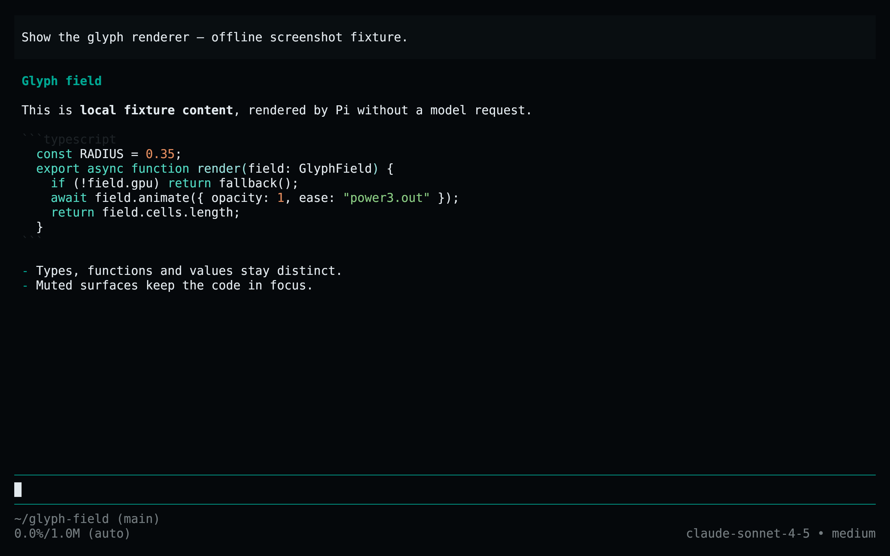
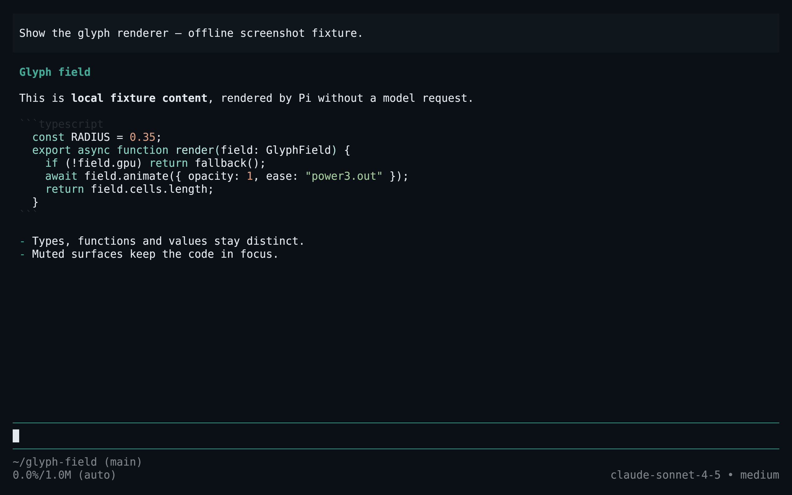
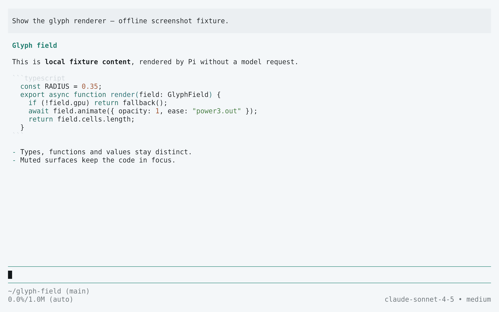
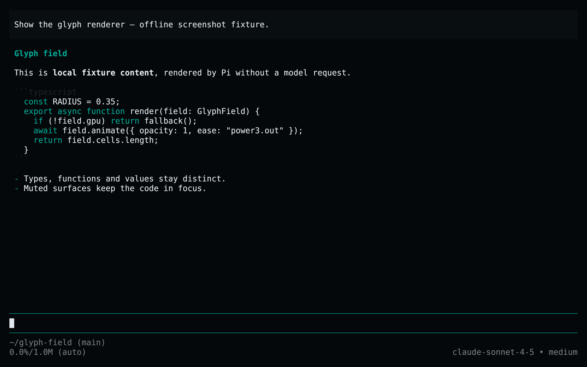

<!-- living-code-readme:1 -->
# 🥧 Living Code for Pi

**Calm slate. Living color.** Living Code for Pi: schema-complete custom themes for messages, tools, thinking levels, syntax, Markdown and HTML exports.

[Installation](#installation) · [Flavors](#flavors) · [Configuration](#configuration) · [All ports](https://github.com/living-code-theme)

## Previews

<table data-lc-flavors>
<tr>
<td width="50%" valign="top">
<strong>Night</strong><br><sub>Dark · full palette</sub><br><br>
<a href="images/night.png"></a>
</td>
<td width="50%" valign="top">
<strong>Frost</strong><br><sub>Dark · softer chroma</sub><br><br>
<a href="images/frost.png"></a>
</td>
</tr>
<tr>
<td width="50%" valign="top">
<strong>Paper</strong><br><sub>Light · near-white slate</sub><br><br>
<a href="images/paper.png"></a>
</td>
<td width="50%" valign="top">
<strong>Signal</strong><br><sub>Dark · teal accent</sub><br><br>
<a href="images/signal.png"></a>
</td>
</tr>
</table>

Select any preview to view the image at full size.

## Installation

```sh
flavor=night # night, frost, paper, or signal
curl -fsSL --create-dirs -o "${PI_CODING_AGENT_DIR:-$HOME/.pi/agent}/themes/living-code-$flavor.json" "https://raw.githubusercontent.com/living-code-theme/pi/main/themes/living-code-$flavor.json"
pi --use-theme "living-code-$flavor"
```

In an already running Pi session, run `/reload` and choose the installed flavor under `/settings` → **Theme**. `PI_CODING_AGENT_DIR` is respected. Only the theme JSON is downloaded; no package manager, extension, or repository clone is needed.

## Flavors

Expand a flavor for its full-size preview and activation instructions.

<details data-lc-flavor="night">
<summary><strong>Night</strong> · Dark · full palette</summary>

<p><a href="images/night.png"></a></p>

```sh
pi --use-theme living-code-night
```

</details>

<details data-lc-flavor="frost">
<summary><strong>Frost</strong> · Dark · softer chroma</summary>

<p><a href="images/frost.png"></a></p>

```sh
pi --use-theme living-code-frost
```

</details>

<details data-lc-flavor="paper">
<summary><strong>Paper</strong> · Light · near-white slate</summary>

<p><a href="images/paper.png"></a></p>

```sh
pi --use-theme living-code-paper
```

</details>

<details data-lc-flavor="signal">
<summary><strong>Signal</strong> · Dark · teal accent</summary>

<p><a href="images/signal.png"></a></p>

```sh
pi --use-theme living-code-signal
```

</details>

## Configuration

Themes include every required color and the optional search, scrollbar and maximum-thinking colors. Export page/panel backgrounds are explicit. In `~/.pi/agent/settings.json`, `"theme": "living-code-paper/living-code-night"` follows the terminal appearance, with the light theme first. Package resources declare only themes: no tools, extensions or prompts are installed.

## Compatibility

Verified against the Pi 1.1.0 theme schema and native JSON validator. Requires a Pi release supporting these theme roles. User themes hot-reload when the theme name matches the JSON filename; package themes can be refreshed with `/reload`. Project-scoped resources require project trust. Truecolor is recommended. No provider login or model call is needed to use or validate the theme.

Previews are captured programmatically from the actual application in an isolated profile. See [`capture/app.py`](capture/app.py) for the app-owned recipe and [`images/capture.json`](images/capture.json) for runtime, palette and image provenance. No mock interface is drawn.

## Contributing

Found a problem? [Open an issue](https://github.com/living-code-theme/pi/issues/new/choose) with the app version, the flavor and a screenshot. Want Living Code somewhere else? [Request a port](https://github.com/living-code-theme/core/issues/new?template=port-request.yml).

Pull requests are welcome. Keep this README, `port.json` and `images/` in sync, and use real screenshots of the app, never mockups.

🦎 **One chameleon, many habitats.** Part of [Living Code](https://github.com/living-code-theme).

## License

[MIT](LICENSE) © Elliot Luque. The bundled upstream Pi theme schema is [MIT](test/fixtures/PI-LICENSE) © Mario Zechner.
